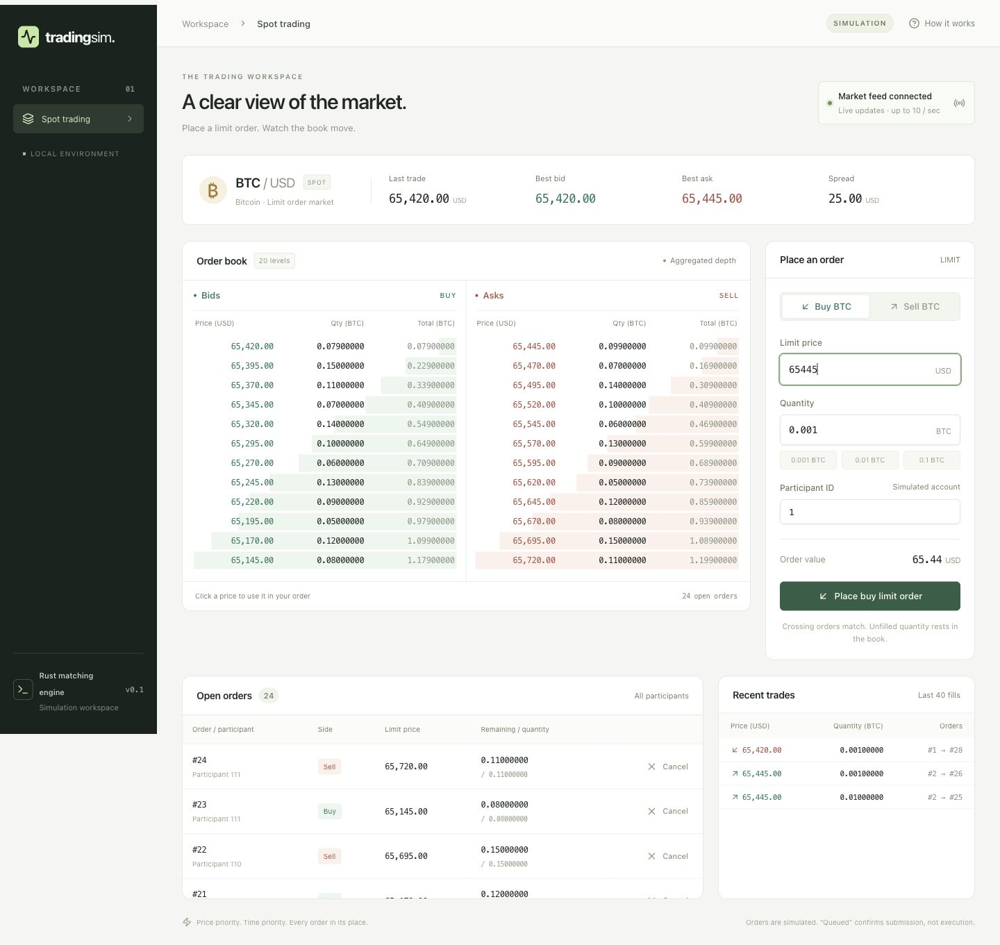
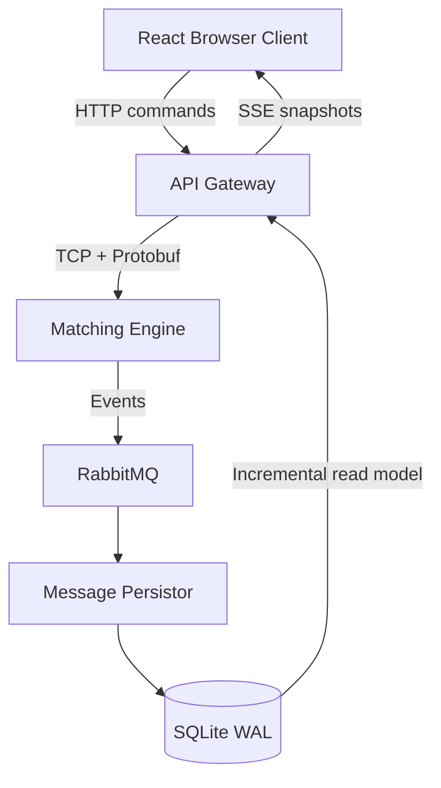
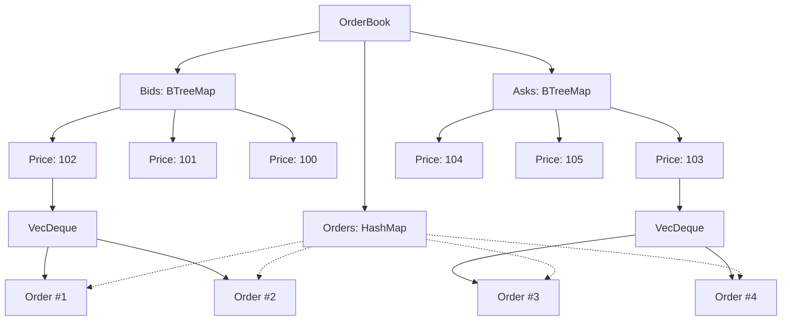
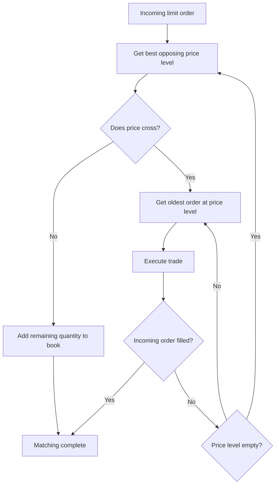

# Trading Engine

A Rust-based trading engine built around a price-time priority order book, with a TCP command interface and asynchronous event-driven persistence.

The project explores the architecture and engineering challenges behind a trading system: order matching, efficient data structures, inter-service communication, event distribution, and persistence.

## Try the trading workspace

```sh
npm ci
npm run dev -- --seed
```

Open [the local workspace](http://127.0.0.1:5173). This starts all services with an
isolated database/queue and seeds actual simulated liquidity through the API.
Omit `--seed` for an empty book. Requires Node 24, Rust 1.92+, protoc, and Docker.



Order tracking adds only a correlation ID echoed in the existing acceptance event;
matching does not build UI snapshots. A gateway-side projection reads the
existing persisted event log and shares snapshots over SSE at up to 10 Hz. Browser
count and slow rendering do not add snapshot work or locks to the matching thread.
See [the frontend guide](web/README.md) for the data path, consistency boundaries,
and commands for running individual services.

## Architecture

The monorepo contains three Rust services and a React browser client:



### Components

| Component | Responsibility | Technologies |
|---|---|---|
| `web` | Limit order entry, live depth, open orders, and recent fills | React, TanStack Query, shadcn/ui, Vite |
| `api-gateway` | Forwards commands and serves an independent persisted-event market projection | Actix Web, Tokio, SQLx, SSE |
| `engine` | Maintains the order book, processes orders, and publishes events | Rust, Tokio, RabbitMQ |
| `message-persistor` | Consumes events and persists trading data | RabbitMQ, SQLx, SQLite |

### Communication

The API gateway communicates with the matching engine over TCP using Protocol Buffers.

Messages are length-prefixed, allowing the receiver to determine message boundaries over the TCP stream.

The matching engine publishes events to RabbitMQ. A separate consumer processes those events and persists them to SQLite, keeping database operations outside the matching path.

## Order Book

The matching engine implements a price-time priority order book.

Orders are organized by price level, with FIFO ordering within each level:

- `BTreeMap` maintains ordered price levels.
- `VecDeque` maintains insertion order within each price level.
- `HashMap` provides direct lookup of orders by ID.

Buy orders are matched against the lowest available ask, while sell orders are matched against the highest available bid.

When an incoming limit order crosses the spread, the engine consumes available liquidity according to price priority and then time priority. Any remaining quantity is added to the corresponding side of the book.

### Supported operations

- Place limit orders
- Cancel open limit orders
- Match incoming orders against existing liquidity
- Generate order acceptance, cancellation, and trade events

## Event-Driven Persistence

The matching engine emits events rather than directly interacting with the database.

Currently, the event flow includes:

- `OrderAccepted`
- `OrderCancelled`
- `TradeOccurred`

Events are serialized using Protocol Buffers and published to RabbitMQ.

The message persistor consumes these events and stores the corresponding records in SQLite.

This separation keeps persistence concerns independent of the matching engine.

## Correctness and reliability

The matching loop has one writer on a dedicated thread. Tests cover price priority,
FIFO, maker-price execution, partial fills, quantity conservation, and cancellation
at every queue position on both sides. A deterministic 4,000-command workload is
also checked against a separate vector-based reference model.

- Invalid sides, zero values, unsupported pairs, and values outside the supported
  signed 64-bit range are rejected before matching. The gateway limits currency
  symbols to 32 bytes so generated commands fit the TCP frame limit.
- TCP commands use a four-byte big-endian length prefix, capped at 4 KiB.
  Malformed frames close their connection rather than panicking.
- Engine command and event queues each hold at most 1,024 messages; the gateway
  holds at most 10,000 commands and returns `503` when its queue is full.
- Both AMQP services declare the durable queue. Events have UUID message IDs,
  persistent delivery mode, mandatory routing, and publisher confirms.
- The persistor commits each event receipt and its database change together.
  Redelivery with the same ID and bytes is a no-op; conflicting reuse is rejected.
- SQLite stores execution price and correct maker/taker IDs using checked `i64`
  conversions. Cancellation sets an explicit flag on the accepted-order record.

These are bounded, specific guarantees. The book and pending commands/events are
in memory. There is no durable command journal, book replay, or automatic engine
recovery. See [LOCAL_RUN.md](LOCAL_RUN.md) for the restart boundary and limitations.

## Performance

The Criterion suite measures no-match insertion, one-order matching, walking five
price levels, partial fills, and cancellation. Each fixture has 1,000 bid levels
and 1,000 ask levels. `iter_batched_ref` excludes fixture creation and book
destruction from the timed operation.

```sh
cargo bench -p engine
```

See [BENCHMARKS.md](BENCHMARKS.md) for the environment, results, and methodology.
These are in-process order-book measurements; they do not measure HTTP, TCP,
RabbitMQ, or SQLite latency. Earlier README figures included book destruction
and are not comparable to the current benchmark methodology.

## Technology Stack

- **Frontend:** React, TypeScript, TanStack Query, shadcn/ui, Tailwind CSS
- **Language:** Rust
- **Async runtime:** Tokio
- **HTTP:** Actix Web
- **Serialization:** Protocol Buffers
- **Messaging:** RabbitMQ
- **Persistence:** SQLite, SQLx
- **Benchmarking:** Criterion.rs

## Current Scope and Future Work

This is an experimental project intended to explore trading-system architecture and order-book implementation. It is not a production trading platform.

Potential improvements include:

- Market order support
- Order modification
- Expanded matching-engine test coverage
- Durable command journaling and deterministic book replay
- Dead-letter handling and operational metrics
- Improved benchmark coverage and performance analysis
- Market data distribution and candle generation
- Correlated command acknowledgments and order-status queries
- Multi-engine deployment and service discovery

## Order book design


The order book maintains separate bid and ask sides, each organized by price. Each price level contains a FIFO queue, ensuring orders at the same price are matched in arrival order. A separate hash map provides direct access to orders by ID, allowing efficient cancellation without scanning the entire book.


    
## Running the Project

Prerequisites: Rust 1.92+, `protoc`, and Docker Desktop/Engine. On macOS, install
`protoc` with `brew install protobuf`.

```sh
cargo build --workspace --locked
cargo test --workspace --locked
docker compose up -d
python3 scripts/smoke_test.py
```

The automated demo creates an isolated queue and temporary database, runs all
three services on available ports, and verifies a limit trade, cancellation,
large integer values, malformed-input isolation, duplicate-event handling, and a
persistor restart. It cleans up its processes, queue, and database afterward.

For interactive startup, HTTP examples, and database upgrade notes, see
[LOCAL_RUN.md](LOCAL_RUN.md). The persistor automatically creates and migrates a
fresh database; compilation requires no database or `DATABASE_URL`.

CI runs formatting, tests, Clippy, the end-to-end demo with RabbitMQ, and benchmark
compilation. Market orders and order modification remain unsupported.
