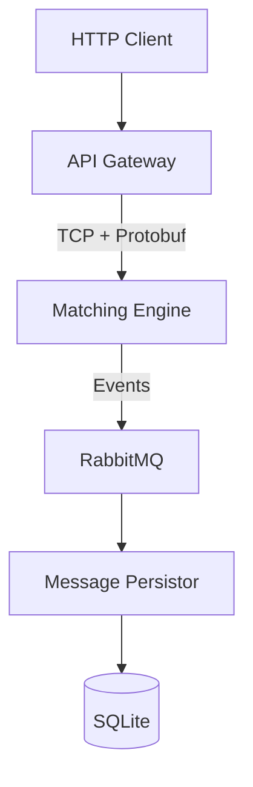

# Trading Engine

A Rust-based trading engine built around a price-time priority order book, with a TCP command interface and asynchronous event-driven persistence.

The project explores the architecture and engineering challenges behind a trading system: order matching, efficient data structures, inter-service communication, event distribution, and persistence.

## Architecture

The system is divided into three independent processes:



### Components

| Component | Responsibility | Technologies |
|---|---|---|
| `api-gateway` | Accepts HTTP requests and forwards commands to the matching engine | Actix Web, Tokio |
| `engine` | Maintains the order book, processes orders, and publishes events | Rust, Tokio, RabbitMQ |
| `message-persistor` | Consumes events and persists trading data | RabbitMQ, SQLx, SQLite |

### Communication

The API gateway communicates with the matching engine over TCP using Protocol Buffers.

Messages are length-prefixed, allowing the receiver to determine message boundaries over the TCP stream.

The matching engine publishes events to RabbitMQ. A separate consumer processes those events and persists them to SQLite, keeping database operations outside the matching path.

## Order Book

The matching engine implements a price-time priority order book.

Orders are organized by price level, with FIFO ordering within each level:

- `BTreeMap` maintains ordered price levels.
- `VecDeque` maintains insertion order within each price level.
- `HashMap` provides direct lookup of orders by ID.

Buy orders are matched against the lowest available ask, while sell orders are matched against the highest available bid.

When an incoming limit order crosses the spread, the engine consumes available liquidity according to price priority and then time priority. Any remaining quantity is added to the corresponding side of the book.

### Supported operations

- Place limit orders
- Cancel open limit orders
- Match incoming orders against existing liquidity
- Generate order acceptance, cancellation, and trade events

## Event-Driven Persistence

The matching engine emits events rather than directly interacting with the database.

Currently, the event flow includes:

- `OrderAccepted`
- `OrderCancelled`
- `TradeOccurred`

Events are serialized using Protocol Buffers and published to RabbitMQ.

The message persistor consumes these events and stores the corresponding records in SQLite.

This separation keeps persistence concerns independent of the matching engine.

## Performance

The order book is benchmarked using [Criterion.rs](https://github.com/bheisler/criterion.rs).

The benchmark suite covers three scenarios:

| Benchmark | Scenario | Recorded time |
|---|---|---:|
| `add_limit_order_no_match` | Add an order without matching existing liquidity | 111.37 µs |
| `add_limit_order_full_match_one` | Fully match against one existing order | 111.31 µs |
| `add_limit_order_walk_the_book` | Consume liquidity across multiple price levels | 116.27 µs |

These are previously recorded results from September 22, 2025, and should be treated as historical measurements rather than current performance guarantees.

Run the benchmarks with:

```bash
cargo bench -p engine
```

## Technology Stack

- **Language:** Rust
- **Async runtime:** Tokio
- **HTTP:** Actix Web
- **Serialization:** Protocol Buffers
- **Messaging:** RabbitMQ
- **Persistence:** SQLite, SQLx
- **Benchmarking:** Criterion.rs

## Current Scope and Future Work

This is an experimental project intended to explore trading-system architecture and order-book implementation. It is not a production trading platform.

Potential improvements include:

- Market order support
- Order modification
- Expanded matching-engine test coverage
- Idempotent event processing
- Backpressure and bounded event channels
- Improved benchmark coverage and performance analysis
- Market data distribution and candle generation
- A frontend for interacting with the engine
- Multi-engine deployment and service discovery

## Running the Project

The project is organized as a Cargo workspace:

```text
trading-sim/
├── api-gateway/
├── engine/
├── message-persistor/
├── migrations/
├── proto/
└── Cargo.toml
```

Each service has its own configuration directory. RabbitMQ is required for event publishing and consumption.

See the configuration files in each service for the required environment-specific settings.
